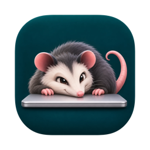
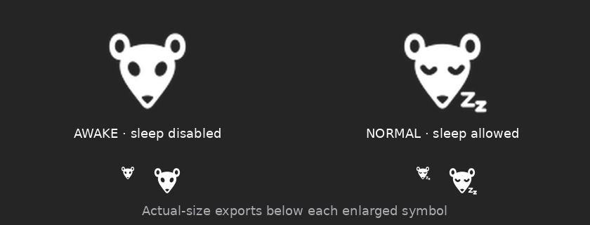

<p align="center">
  
</p>

<h1 align="center">Possum</h1>

<p align="center">
  A minimal macOS menu bar app that keeps your Mac awake, <b>even with the lid closed</b>.
</p>

<p align="center">
  <a href="https://github.com/Magwest1/possum/actions/workflows/ci.yml"></a>
  <a href="https://github.com/Magwest1/possum/releases/latest"></a>
  <a href="LICENSE"></a>
</p>

---

Apps like Amphetamine and `caffeinate` use power assertions. Those stop *idle* sleep, but they
don't stop the sleep that happens when you close the lid. Possum flips the system-wide
`SleepDisabled` flag with `pmset disablesleep` instead. A small privileged helper does the
flipping, and you approve it once.

<p align="center">
  
</p>

## Features

- **Prevent Sleep**: one click. It works with the lid closed, too.
- **Prevent Sleep For…**: 30 min to 8 h, then normal sleep comes back automatically.
- **Verified status**: the icon shows what `pmset -g` actually reports. It re-checks every
  15 seconds and every time you open the menu, not just what the app last asked for.
- **Enable Sleep and Quit**: restores normal sleep before quitting. A plain *Quit* leaves the
  setting alone, on purpose.
- **Launch at Login**.
- No password prompts after the one-time helper approval.

## Install

1. Download `Possum-x.y.z.dmg` from the [latest release](https://github.com/Magwest1/possum/releases/latest)
   and drag Possum to **Applications**. Releases are signed with a Developer ID and notarized by Apple.
2. Launch Possum and pick **Prevent Sleep** from the possum in the menu bar.
3. The first time, macOS asks you to allow the background helper:
   **System Settings › General › Login Items & Extensions › Possum**. Switch it on, then choose
   **Prevent Sleep** again.

Requires macOS 13 Ventura or later. Universal binary (Apple silicon and Intel).

## ⚠️ Read this before closing the lid

With sleep disabled, a closed MacBook keeps running at full power. **Don't put it in a bag or
sleeve while sleep is disabled.** It can overheat and drain the battery. Use a timer, or
**Enable Sleep and Quit**, when you're done.

The setting is system-wide and persists until it is turned off, even across a Possum quit or
crash. To restore it manually:

```bash
sudo pmset disablesleep 0
```

Test lid-close behaviour on your own Mac and macOS version before you rely on it.

## How it works

| Piece | Role |
| --- | --- |
| `Possum.app` | Menu bar UI (AppKit). Reads status with `pmset -g`, which doesn't need root. |
| `PossumHelper` | LaunchDaemon embedded in the app bundle and registered with `SMAppService`. Runs as root and is started on demand by launchd. Exits after 60 s idle. |
| XPC | One method, `setSleepDisabled(Bool)`. Each side checks the other's code signature (same Apple team). |

The helper only ever runs `/usr/bin/pmset disablesleep 1` or `/usr/bin/pmset disablesleep 0`.
See [SECURITY.md](SECURITY.md).

### Uninstall

1. Choose **Enable Sleep and Quit**.
2. Switch Possum off in **System Settings › General › Login Items & Extensions**.
3. Delete Possum from Applications.

## Building from source

```bash
make test     # unit tests
make run      # ad-hoc signed build for this Mac, then launch
make dmg      # local DMG
```

Only the Swift toolchain is needed (Xcode or the Command Line Tools). There's no Xcode project:
`scripts/build-app.sh` builds the Swift package and assembles the bundle.

Releasing is automated with release-please and GitHub Actions. See [docs/RELEASING.md](docs/RELEASING.md).

## License

[MIT](LICENSE) © Magnus Ølstad
